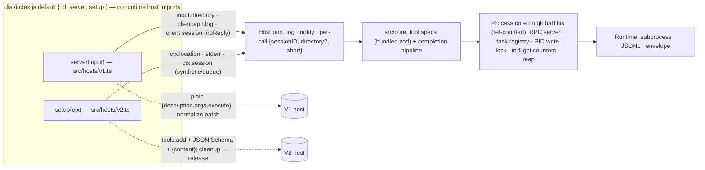

# feat: Support OpenCode V1 and V2 hosts from one package

## Overview

OpenCode V2 (`@opencode/cli` and `@opencode/plugin` 2.3.x) replaced the plugin API:
- The plugin package was renamed.
- Plugins are defined with `Plugin.define({ id, setup })`.
- Tools register through `ctx.tool.transform`, which hands `setup` a `tools` registry; you register with `tools.add`.
- There is no `client` or `$`.
- The TUI API is new.

This plugin currently loads only on V1 (`@opencode-ai/plugin` 1.x).

This plan keeps one package with one default export that serves both hosts, following `marcusrbrown/systematic`. A shared core holds the tool specs, the completion pipeline, and the process-wide runtime. Thin V1 and V2 adapters wrap it for the server entry, tools, notifications, and logging, and later the TUI. The plan also folds in #530 item 2: tool hooks become per-directory instead of first-caller-wins per process.

## Problem Frame

- V2 hosts can't load the plugin. `fro-bot/agent` and other V2 adopters already run stock V2 only.
- Serving V2 alone would strand every V1 user. The repo's peer floor is `>=1.14.41`, and the `mise.toml` host is `1.19.6`.
- The per-process singleton (`src/runtime/plugin-singleton.ts`) gives the first factory call real hooks and every later call `{}`. A shared server with several workspaces therefore gets no tools after the first workspace (#530 item 2). V2 adds per-location `setup` plus plugin reload and reactivation, which breaks the singleton's assumptions outright.
- Today's build also binds the plugin to V1 at runtime. The tools import `tool` from `@opencode-ai/plugin/tool` as a value and build their schemas with `tool.schema` (the host package's zod), and `scripts/build.ts` keeps that import external. A V2-only install fails to load the module before any adapter runs.

## Requirements Trace

- R1. On supported V1 hosts (the existing `>=1.14.41` floor through `1.19.x`), the plugin behaves as it does today: four `copilot_*` tools, notifications, and the TUI. The one intended change is R4's per-directory hooks.
- R2. On a V2 host (`2.3.x`), the plugin loads, registers the same four tools with equivalent inputs and outputs, and delivers completion and failure information to the parent session per R6.
- R3. One package with one default export. `dist/index.js` exports only `default`, keeping the 2026-05-11 regression contract. The built server entry imports **neither** host package at runtime, so it loads when only one host package, or neither, is resolvable.
- R4. Each directory a host process serves gets its own tool hooks bound to that directory. Duplicate config sources for the same directory still get `{}` on V1 (the #76/#108 contract). Process-wide state starts once per process, whichever module instance gets there first: the RPC server, task registry, PID ledger and its write lock, in-flight counters, and orphan reap. On V2, that state is released when the last activation's cleanup runs. On V1, it is held for the life of the process.
- R5. V2 reload and reactivation is safe. After setup → cleanup → setup, exactly one port file exists, pointing at the live server's port and token. This also holds when several locations clean up at once (V2 shutdown runs them concurrently), and if a future host stops awaiting cleanup: 2.3.2 does await it, and the guard is defence in depth. No PID entries are lost or leaked. Copilot tasks still running at release follow the in-flight policy in Key Technical Decisions.
- R6. A notification failure never fails a tool call on either host. V2 keeps V1's two-mode contract: a silent notice while other tasks are still running, and a turn-starting notice for the last completion and for failures or cancellations (see Key Technical Decisions for the mapping).
- R7. CI proves both hosts on every PR that touches the contract surface. The export-shape smoke test runs. A host-contract load test runs against the V1 floor, V1 current, and V2 pinned, each installing the packed tarball in a clean directory where only that host's package is present.
- R8. The TUI half works on both hosts (phase 2), within the OpenTUI constraints: the V1 host uses 0.4.5 and the V2 peer requires `>=0.8.4`.

## Scope Boundaries

- Copilot CLI behavior, tool semantics, and JSONL parsing are unchanged.
- No new tools. The unshipped session-continuity Units 4–6 (`docs/plans/2026-05-02-001-feat-copilot-session-continuity-resume-connect-plan.md`) stay deferred.
- No V2-only features (permissions, MCP, references, integrations) beyond what parity needs.
- V1 support is not dropped in this plan.

### Deferred to Separate Tasks

- OpenTUI 0.4.5 alignment and the `brace-expansion` override: `docs/plans/2026-11-20-001-fix-opentui-host-alignment-plan.md`. This lands first.
- Wall-clock-flaky unit tests: resume's no-match window, the tools timeout race, and the subprocess grandchild pid wait. These are a separate test-hygiene fix, tracked in an issue to be opened before Unit 5. The CI matrix in Unit 5 depends on them being fixed.
- Integration tests that need model auth (#38).

## Context & Research

### Relevant Code and Patterns

- `src/index.ts`: the V1 factory. It wires `input.directory` and `input.client` into the tools, the RPC runtime, the reaper, and `plugInOnce`. The test hook `__captureRpcCleanup` needs a new home.
- `src/tools/{delegate,output,cancel,resume}.ts`: these use the V1 `tool()` from `@opencode-ai/plugin/tool` (a value import), build schemas with `tool.schema.*` (host zod), and return JSON-string results. They use `ctx.sessionID` as the parent session for notifications and in-flight counts.
- `src/lib/normalize-tool-arg-schemas.ts`: imports `tool` from the host package and patches zod JSON Schema metadata for the V1 host's separate zod.
- `src/runtime/notify.ts`: `client.session.prompt/promptAsync({ noReply, parts: [{ synthetic: true }] })`, `client.app.log`, and `client.tui.showToast`. It forces a turn for `failed` and `cancelled` tasks whatever else is in flight. `buildNotificationText(task)` describes a single task. In-flight counters are module-level (`inFlightCounters`).
- `src/runtime/task-registry.ts`: a module-level `tasks` Map. `cleanupAll()` has no production caller.
- `src/runtime/pid-file.ts`: does read-modify-write plus rename on `${pid}.pids`, serialized by a module-level `writeChains` lock.
- `src/runtime/orphan-reaper.ts`: treats the current PID's file as reapable, killing its entries and truncating it.
- `src/runtime/rpc-server.ts`: `listen(0, '127.0.0.1')` (ephemeral port). Its exclusive resource is the port file `<cache>/opencode/copilot-delegate/<OPENCODE_SESSION_ID ?? pid>/server-port.json`, which start cleans stale and `close()` removes. After #561, the path functions live in `src/runtime/rpc-paths.ts`.
- `src/runtime/plugin-singleton.ts`: a `globalThis` `Symbol.for` singleton. State must live on `globalThis`, because module state resets between factory calls (#76 probe).
- `scripts/build.ts`: the server builds with `target: 'node'`, the TUI with `target: 'bun'` plus `@opentui/solid/bun-plugin`. `@opencode-ai/plugin` is external.
- `.github/workflows/ci.yaml`: the Node ESM smoke test asserts `typeof default === 'function'`. CI runs `test:unit` but not `test:tui`.
- `tests/package-exports.test.ts`: asserts the default is a function, and asserts the TUI entry `toEqual({ id, tui: Function })`.
- `.github/settings.yml`: required status-check `contexts`.
- Systematic main is the reference implementation:
  - One default object `{ id, setup, server }`. `setup` returns early when `!ctx.location || !ctx.session`, which is V1's reduced bridge.
  - Adapters in `src/lib/opencode-v1.ts` and `src/lib/opencode-v2*.ts`.
  - Two optional peers.
  - The public `.d.ts` types the entry as `unknown`.
  - A CI Host Contract job runs V2 shards, the V1 floor, and V1 current, with pins in `scripts/opencode-host-pins.json`.
- `@opencode-ai/plugin@1.19.6` also ships `./v2/promise` and `./v2/effect` subpaths. Those are **not** the 2.3.x API; import V2 types only from `@opencode/plugin`.

### Host Facts

| Concern | V1 (`v1.19.6`) | V2 (`v2.3.2`) |
|---|---|---|
| Server entry resolution | `exports["./server"]`, else `main` | `server` subpath, else root `"."` |
| Default shape | Object with `id` + `server`, or a legacy factory (then every named export is iterated as a factory) | Must be `{ id, setup }` or `{ id, effect }`; named exports ignored |
| `oc-plugin` field | — | Not read (inferred) |
| Per-directory | One factory call per instance directory (`InstanceState`); `ToolContext` also carries a per-call `directory`/`worktree` | `setup` once per location per activation; module re-evaluated per location and per file edit; reactivation awaits the prior cleanup; shutdown runs all locations' cleanups concurrently (probe) |
| Dedupe | None; each config source calls the factory | By `id` within an instance |
| Tools | `tool()` (identity) + zod, string result | `ctx.tool.transform` → `tools.add({ name, description, input, execute })`; `input` accepts effect Schema, Standard Schema, or JSON Schema; result `{ output?, content?, metadata? }` |
| Session injection | `session.prompt/promptAsync({ noReply })` | `session.synthetic` / `session.prompt({ sessionID, text, delivery?, resume? })`. `delivery` defaults to `steer` (joins the active turn); `queue` waits for it. `resume: false` adds the message without starting a turn, which is the `noReply: true` analogue (source) |
| Logging | `client.app.log` | None; stderr only (Systematic uses a prefixed `console.error`) |
| TUI module sharing | `runtime-plugin-support` shares `solid-js`, `@opentui/core`, `@opentui/solid` with externalized plugin imports (probe) | Same set plus `@opencode/plugin/tui`; `PluginContextProvider` identity holds (probe) |
| TUI process | — (unmeasured) | Separate process from the server in every mode; `OPENCODE_SESSION_ID` unset in both (probe) |
| Default carrying `server` + `tui` | Rejected; server and TUI need separate entries (probe) | — |
| Tool `execute` context | `sessionID`, `directory`, `worktree`, `abort` | `sessionID`, `agent`, `messageID`, `id`, `progress`, `signal`; no directory (use `ctx.location.directory` from `setup`) |
| Runtime | Server: Node or Bun | Server: Node or Bun; TUI: Bun only |

Facts are verified against source unless marked inferred.

### Institutional Learnings

- `docs/plans/2026-05-11-001-feat-plugin-contract-and-tui-api-resilience-plan.md` is recorded as completed (#121, #123). Keep its decisions on default-only export, the Node build target, and the failing CI gate. Its R6, which keeps `plugInOnce` and rejects per-load models, is **partly superseded** here. V1 keeps dedupe, now per-directory. V2 drops the guard in favor of `setup` + cleanup over a shared process core.
- `docs/research/copilot-memory-experiment-2026-05-03.md` describes the dual pattern: on V1, both `normalizeToolArgSchemas` and `plugInOnce` are required. Unit 1 re-verified it with bundled zod. `normalizeToolArgSchemas` is still needed below 1.15.1, which includes the 1.14.41 floor: unpatched bundled zod lost descriptions on 1.14.41 and 1.14.49 and kept them on 1.15.2+. `plugInOnce` is still needed, because V1 called `server()` twice for two specifiers with the same id.
- `docs/solutions/integration-issues/two-entrypoint-rpc-tui-hardening-2026-05-01.md`:
  - RPC and TUI startup are best-effort and never block tool registration.
  - The session discriminator is validated before use.
  - Cleanup removes only the exact stale port file. (Superseded in #575: a sibling sweep also removes stale and empty dirs.)
  - The export smoke test stays.
- `docs/solutions/best-practices/per-instance-pid-files-spawner-liveness-gating-2026-04-28.md` and `docs/plans/2026-04-27-002-fix-runtime-hardening-plan.md` (completed): the PID ledger assumes one spawner per host process. Per-directory hooks in one process must share one ledger and one write lock.
- `docs/solutions/best-practices/reliable-cli-integration-testing-2026-04-26.md`: host tests drive the CLI with config-dir isolation rather than an SDK harness.
- `docs/solutions/ui-bugs/re-entrant-dialog-close-froze-copilot-status-on-escape-2026-05-02.md`: the host owns dialog close. The V2 `ui.dialog.show` path needs the same no-re-entrant-close test.
- `docs/plans/2026-04-21-copilot-delegate-plugin.md` (T4) is the notification contract. `noReply: true` injects while other tasks are running. `noReply: false` is used when the last in-flight task completes, and for failures and cancellations.

## Prior-Art Survey

```json
{
  "schema_version": 2,
  "verdict": "extend",
  "scope": "src/index.ts, src/tools/, src/runtime/{notify,plugin-singleton,task-registry,rpc-server,rpc-paths,pid-file,orphan-reaper}.ts, src/lib/, src/tui/, scripts/build.ts, tests/package-exports.test.ts, .github/workflows/ci.yaml, .github/settings.yml",
  "freshness": {
    "vcs_reference": "origin/main@15b2a9a"
  },
  "budget": {
    "max_search_passes": 3,
    "max_candidate_inspections": 10,
    "exhausted": false
  },
  "candidates": [
    {
      "path_or_symbol": "src/runtime/plugin-singleton.ts plugInOnce",
      "description": "Process-wide register-once guard on globalThis; duplicates get {}",
      "disposition": "extend"
    },
    {
      "path_or_symbol": "src/runtime/notify.ts",
      "description": "Completion injection via client.session prompt with noReply, toast, app.log; module-level in-flight counters",
      "disposition": "extend"
    },
    {
      "path_or_symbol": "src/tools/*.ts",
      "description": "Four V1 tool definitions mixing schema (host zod via tool.schema), execution, and host result shape",
      "disposition": "extend"
    },
    {
      "path_or_symbol": "src/lib/normalize-tool-arg-schemas.ts",
      "description": "V1-only zod JSON Schema metadata patch; imports the host package at runtime",
      "disposition": "extend"
    },
    {
      "path_or_symbol": "src/runtime/{task-registry,pid-file}.ts",
      "description": "Module-level task map and PID write lock that must become process-wide",
      "disposition": "extend"
    },
    {
      "path_or_symbol": "src/runtime/{subprocess,jsonl-parser,envelope,rpc-server,rpc-paths,orphan-reaper}.ts",
      "description": "Host-agnostic runtime",
      "disposition": "reuse"
    }
  ]
}
```

## Key Technical Decisions

- **No runtime host imports in the server entry.**
  - Host packages are type-only imports.
  - The core builds tool schemas with the plugin's own bundled `zod`.
  - The V1 adapter returns plain `{ description, args, execute }` objects, because V1's `tool()` is an identity function.
  - `normalizeToolArgSchemas` is re-pointed at the bundled zod.
  - Neither host package is a runtime external of `dist/index.js`.
  - R3 makes this enforceable, and Unit 5's clean-install test proves it.
- **One default object, `{ id, server, setup }`.** The `./tui` entry also gets `setup` beside `tui`, in phase 2. Systematic shows that V1 1.19 reads `server` and V2 reads `setup`. A single file avoids depending on an untested split between `main` and `"."`, and keeps the default-only contract. `setup` returns early on V1's reduced bridge.
- **Adapters at the edges, one core.**
  - The core takes a host port with two kinds of input:
    - A per-adapter part: log sink and notification sink.
    - A per-call context: `sessionID`, optional `directory`, and `abort`.
  - The core returns tool specs: name, description, zod schema, and an execute that returns a plain result.
  - Adapter paths are `src/hosts/v1.ts` and `src/hosts/v2.ts`. Shared code lives in `src/core/`.
  - The V2 adapter registers through `ctx.tool.transform`'s `tools.add`. Its `input` is the same zod schema, passed directly as Standard Schema; Unit 1 verified this for zod 4.2+, including a separately bundled copy. Because `tools.add` silently skips a tool whose schema fails to convert, the adapter asserts after registration that all four tools are present, and the package keeps a zod `>=4.2` floor. It returns `{ content }`. The four tools can't drift between hosts.
- **Directory precedence.** A tool uses the per-call directory when the host supplies one (V1 `ToolContext.directory`, or the V2 location). Otherwise it falls back to the directory bound at registration. `copilot_resume`'s `allowedRoots` containment uses the same resolved directory and never a union of the two, which keeps it a strict boundary.
- **Process core on `globalThis`, reference-counted.**
  - It owns everything that must be process-wide, whichever module instance runs:
    - the RPC server and its task accessors
    - the task registry
    - the PID ledger write lock
    - per-session in-flight counters
    - orphan reap
  - V1 acquires on the first factory call and never releases. V2 acquires in `setup` and releases in cleanup.
  - Acquire waits on any pending release, so a cleanup that isn't awaited can't delete the next server's port file. 2.3.2 awaits cleanup; this is defence in depth.
- **In-flight policy on release: cancel.** When the last V2 activation releases, the process core first cancels running Copilot tasks (`cleanupAll`), then closes RPC (removing its own port file only), then truncates the ledger. Re-binding tasks to a new activation was rejected. It would need late-bound notify sinks and reaper exemptions for live entries, all to serve a dev-reload case. Cancelling also matches "children don't outlive their plugin".
- **Per-directory V1 hooks.** `plugInOnce` dedupe is keyed by `directory`. The first call for a directory gets hooks bound to it. Repeat calls for that directory get `{}` (#530 item 2, #108). V2 needs no guard, because its registry dedupes by `id`.
- **V2 notifications.**
  - V2 mirrors V1's two modes with `session.synthetic`.
  - A completion while other tasks are still running is `resume: false`, the `noReply: true` analogue. It is a silent notice.
  - The last completion uses `delivery: 'queue'`, so it waits for the active turn, then starts one.
  - Failures and cancellations use `delivery: 'steer'`, which joins the active turn. This matches V1 forcing a turn for them.
  - Unit 1 verified this mapping from source only, because a probe needs a model. Unit 4's tests pin the arguments, and Unit 5's host check confirms it on the first run with a model available.
  - `copilot_output` stays the reliable pull path.
- **Logging on V2** goes to stderr, prefixed `opencode-copilot-delegate:`, behind the same log-sink port. No secrets in logs.
- **Peers and versions.**
  - Both peers are optional: `@opencode-ai/plugin` and `@opencode/plugin >=2.3.0`.
  - The V1 floor stays `>=1.14.41`. Unit 1 found that object defaults with `server` work from 1.3.4.
  - Add `@opencode/plugin` 2.3.x as a devDependency, for types only. Dependency and CI changes are ask-first: approval comes at **Unit 4**, which first edits `package.json` and `ci.yaml`, and again at Unit 5 for the matrix.
  - Ship as `minor` in the 0.x series, with a changeset announcing V2 support.
- **Public types.** `dist/index.d.ts` types the default as `unknown`.
- **Phasing.** Server parity, including its docs, ships as a release on its own (phase 1). The TUI follows (phase 2). It is opt-in, Bun-only on V2, and blocked on OpenTUI `>=0.8.4` and the Solid context-identity question.

## Open Questions

### Resolved During Planning

- Can one package serve both hosts? Yes, with one default object (Systematic, verified).
- Does V2 iterate named exports? No. Only `default` is decoded.
- Does V2 need the zod metadata patch? No. It receives JSON Schema or Standard Schema. The patch stays on the V1 path only.
- What happens to in-flight tasks on V2 release? They are cancelled (see Key Technical Decisions).

### Resolved by Unit 1 spikes

Unit 1's findings are recorded in `docs/research/opencode-v2-host-contract-2026-11.md` and folded into this plan:
- The V1 object default works from 1.3.4, so the floor stays.
- `setup` runs once per location per activation, and reactivation awaits the prior cleanup.
- `synthetic`/`prompt` take `{ sessionID, text, delivery?, resume? }` (source).
- zod 4.2+ works directly as V2 `input`.
- The V2 tool context has `sessionID` and `signal` but no directory.
- Both hosts share Solid and OpenTUI with the plugin.
- `normalizeToolArgSchemas` is still needed below 1.15.1, and `plugInOnce` is still needed.
- Only `useThread: false`, in 20 test sites, blocks OpenTUI 0.6+.

### Deferred to Implementation

- ~~How the V2 TUI finds the server, given that it runs in a separate process with no `OPENCODE_SESSION_ID`.~~ Resolved in Unit 8: the server keys its port file by its pid, and the TUI reads that pid from `ctx.client.server.info()`.
- The live behavior of `resume: false` and `delivery: 'queue' | 'steer'` with a real model. It is source-verified only, and Unit 5's host check confirms it.
- V2 2.3.0 and 2.3.1 were not probed. The pinned host-contract job covers 2.3.2. Add a 2.3.0 shard only if the peer floor stays at `>=2.3.0`.

## High-Level Technical Design

> *This illustrates the intended approach and is directional guidance for review, not implementation specification. The implementing agent should treat it as context, not code to reproduce.*



## Implementation Units

### Phase 0: Spikes (no shipped behavior)

- [x] **Unit 1: Host contract spikes** (done 2026-11-20; see `docs/research/opencode-v2-host-contract-2026-11.md`)

**Goal:** Turn every deferred question into a recorded fact before code moves.

**Requirements:** R1–R6, R8 (de-risking)

**Dependencies:** None

**Files:**
- Create: `docs/research/opencode-v2-host-contract-2026-11.md`

**Approach:** Run throwaway probe plugins against `opencode-ai` (V1 floor candidates, plus 1.19.6) and `@opencode/cli` 2.3.x. Answer each deferred question, recording the version tested and the evidence.

**Test scenarios:**
- Test expectation: none. This unit produces a research artifact, and later units encode its findings as tests.

**Verification:** Every deferred question has either a verified answer or an "unknown + chosen fallback" entry in the research doc.

### Phase 1: Server dual-host (releasable on its own)

- [x] **Unit 2: Host-free build** (done 2026-11-21; scope narrowed, see below)

**Goal:** `dist/index.js` imports no host package at runtime, with no V1 behavior change.

**Requirements:** R1, R3

**Dependencies:** Unit 1

**Files:**
- Create: `src/lib/tool.ts` (a host-free `tool()` identity helper; `tool.schema` is the plugin's bundled zod; host types are imported type-only), `tests/host-free-build.test.ts`
- Modify: `src/tools/*.ts`, `src/lib/normalize-tool-arg-schemas.ts`

**Approach:**
- Schemas use bundled zod. The tool definitions are already plain objects, because V1's `tool()` is an identity function.
- Host packages become type-only imports.
- `{ error }` results stay as they are.

**Scope narrowed (rent test).** The `src/core/` tool specs, the host port, and `src/hosts/v1.ts` have only one caller until the V2 adapter exists, so they move to Unit 4, where the second host justifies them. Unit 2 ships only the invariant that unblocks V2 loading.

**Test scenarios (done):**
- Edge case: a build of `src/index.ts` contains no `@opencode-ai/plugin` or `@opencode/plugin` specifier. Verified red by temporarily restoring one host import.
- Integration: the bundle, copied to a directory with no `node_modules`, imports and exposes only a `default` function.
- Characterization: the existing tool, notify, index, and `normalize-tool-arg-schemas` suites pass unchanged, including the argument-description checks.

**Verification:** Unit and TUI suites are green. A manual Node 24 load from an empty directory printed `[ 'default' ] function`.

- [x] **Unit 3: Process core and per-directory V1 hooks** (done 2026-11-21; release lifecycle moved to Unit 4)

**Goal:** Fix #530 item 2 and share process state across module instances.

**Requirements:** R4 (R5 moves to Unit 4)

**Dependencies:** Unit 2

**Files:**
- Create: `src/lib/process-global.ts` (`Symbol.for`-keyed `globalThis` slots, `.v1`-versioned), `tests/process-core.test.ts`
- Modify:
  - `src/runtime/plugin-singleton.ts`: `plugInOnce` gains a per-directory `key`; a new `initProcessOnce` guards process setup. The header now records the partial supersession of 2026-05-11 R6 and the corrected rationale, which is the port file rather than `EADDRINUSE`.
  - `src/runtime/task-registry.ts`, `src/runtime/pid-file.ts` (write chains), `src/runtime/notify.ts` (in-flight counters): their state moves to process-global slots.
  - `src/index.ts`: split into process setup (reap plus RPC, once) and per-directory hooks.
  - `README.md`: the Scope Boundary section now covers multiple workspaces.
  - `tests/index.test.ts`.

**Approach (as built):**
- The task registry, PID write chains, and in-flight counters live in process-global slots.
- Process setup runs once per process through `initProcessOnce`, which never rejects: an RPC failure is logged and tools still register.
- Hooks are deduped by directory.
- The guard slot was renamed from `singleton` to `hook-guards`, so a Map can't collide with an older release's single-state slot if both load in one process.

**Moved to Unit 4 (rent test):** acquire/release with a count, acquire waiting on a pending release, and the release policy (cancel, then close RPC, then truncate the ledger). V1 never releases, so these would have no caller until the V2 `setup` cleanup exists. Their test scenarios (acquire/acquire/release/release, and an unawaited release followed by an acquire) move with them.

**Test scenarios (done; each red against `main` before the change):**
- Two workspaces each get four tools, and each `copilot_delegate` discovers only its own `.github/agents`.
- Three workspaces in one process: one RPC server; the port-file token is unchanged and no second cleanup is wired.
- Same directory twice gives real hooks, then `{}`. The existing #108 test passes unchanged.
- A task created through one module instance (`?instance=` import) is listed by another, the instance the RPC server reads.
- Twenty interleaved appends and ten removes from two module instances leave exactly the expected ledger.
- In-flight counters are shared: the first of two completions from different instances stays `noReply`, and the last wakes the parent.
- An RPC bind failure leaves tool registration intact. The existing test passes unchanged.

**Verification:** `test:unit` 363/0 on three runs, `test:tui` 31/0, ESM smoke `['default']`. The README states multi-workspace support.

- [x] **Unit 4: V2 server adapter and export-shape gate** (done 2026-11-21; as-built notes below)

**Goal:** The same four tools and completion semantics on V2, with the export shape enforced in CI.

**Requirements:** R2, R3, R5, R6

**Dependencies:** Units 2–3. Approval was given on 2026-11-21 for the `@opencode/plugin` devDependency and optional peer, and for the `ci.yaml` edit.

**Files (as built):**
- Create:
  - `src/core/tools.ts` (`buildTools`)
  - `src/core/process.ts` (`initializeProcess` plus its release teardown)
  - `src/runtime/process-core.ts` (acquire/release with a count)
  - `src/hosts/v1.ts`, `src/hosts/v2.ts`
  - `tests/host-v2.test.ts`, `tests/process-core.lifecycle.test.ts`
- Modify:
  - `src/index.ts`
  - `src/runtime/notify.ts`: an optional `inject` sink with modes `silent | final | urgent`
  - `src/tools/{delegate,resume}.ts`: `client` is now typed as `NotifyClient`
  - `src/runtime/plugin-singleton.ts`: `initProcessOnce` was replaced by the process core
  - `package.json`, `bun.lock`, `.github/workflows/ci.yaml`
  - `tests/package-exports.test.ts`, `tests/host-free-build.test.ts`
  - the V1 tests (`index`, `tools`, `resume`) now call `serverV1`
  - `README.md`, `.github/copilot-instructions.md`, `AGENTS.md`, `.changeset/opencode-v2-server.md`

**Deviations from the plan:**
- **No separate spec/port layer.** Both adapters register `buildTools`' V1-shaped definitions, so the four tools still can't drift between hosts. The host port is the notify sink (`NotifyClient.inject`) plus the log sink. The V2 adapter supplies the per-call context: `sessionID` comes from the call; `directory` is bound at `setup`, because V2 calls carry none; `abort` is `ctx.signal`, read once to opt into cooperative stop.
- **`normalizeToolArgSchemas` is V1-only.** Its per-arg `toJSONSchema` patch breaks zod's whole-object conversion (`seen.ref` TypeError), and V2 uses that conversion through `~standard.jsonSchema.input`. V2 would then have skipped every tool silently. The schema test runs V2's real conversion path and fails if V2 receives normalized args.
- **`dist/index.d.ts` is typed structurally rather than as `unknown`.** It is `{ id: string; server(input: never); setup(context: never) }`, which names no host package and so type-checks with either optional peer missing.
- The zod `>=4.2` floor is already met by `^4.6.7`. The CI smoke test also runs each V2 input through `~standard.jsonSchema.input`.

**Test scenarios (done):**
- `setup` registers exactly four tools. Each V2 input converts as the host converts it, and matches V1's per-arg JSON Schema: properties, descriptions, required fields.
- `execute` returns `{ content }` equal to V1's envelope text.
- A reduced bridge (`{}`, no session, no tool domain) returns `undefined` and starts no process resources.
- With A, B and C in flight: A fails and gets `steer`; B completes and gets `resume: false`; C completes last and gets `queue`. Each injection names its own task.
- `setup` → cleanup → `setup`: the running task is cancelled, the registry is cleared, the registration is disposed, the new activation's port-file token differs, and no notice reaches either activation.
- Two locations share one core, and the port file lives until both have cleaned up.
- A sink failure is logged to stderr and the tool result is unaffected.
- Process core: acquire/acquire/release/release tears down once; concurrent and extra releases tear down once; an unawaited release followed by an acquire waits for the teardown, then starts a new generation; a failing teardown doesn't wedge the next acquire.

**Verification:** `test:unit` 376/0 on three runs, `test:tui` 31/0. Both CI smoke steps were run locally under Node 24 and passed.

- [x] **Unit 5: CI host-contract matrix** (done 2026-11-21; as-built notes below. Local runs are on macOS arm64. The first CI run on linux-x64 is the real proof.)

**Goal:** Prove R1–R3 and R7 against real hosts on every contract-touching PR.

**Requirements:** R1, R2, R3, R7

**Dependencies:** Unit 4; the flaky-test fix (Deferred to Separate Tasks); approval for CI and required-check changes

**Files:**
- Modify: `.github/workflows/ci.yaml` (path-filtered matrix plus an aggregator that always reports), `.github/settings.yml` (aggregator in required `contexts`)
- Create: `scripts/opencode-host-pins.json`, `tests/host-contract/` (load tests), `tests/fixtures/bin/copilot` (a `PATH` shim that replays `tests/fixtures/jsonl/happy-path.jsonl`)

**Approach:**
- For each pin (V1 floor, V1 current, V2 pinned):
  - Pack the plugin.
  - Install the tarball in a clean directory with only that host's package present.
  - Start the host with config-dir isolation.
  - Confirm the plugin loads and lists four tools.
- Tool execution is proved by calling the installed package's `server()`/`setup()` directly with the fake `copilot` shim first on `PATH`. No model auth is needed.
- Install hosts per job, not through `mise.toml`, so the V1 and V2 `opencode` binaries never collide.
- Add `test:tui` to CI, or document it as a local-only gate.
- Optionally, a Renovate rule keeps the pins file current. This is an ask-first config change.

**Test scenarios:**
- Integration: on each pin, the plugin loads from a clean install and exactly four `copilot_*` tools appear.
- Integration: `copilot_delegate` runs against the shim to completion, and `copilot_output` returns the envelope.
- Error path: a deliberately added named export fails the smoke test. A runtime import of a host package fails the clean install on the other host's pin.

**Verification:** Matrix green on a PR. The aggregator is a required check. Red-team PRs fail as expected.

**As built:**
- `scripts/opencode-host-pins.json`: `v1-floor` = `opencode-ai@1.14.41`, `v1-current` = `opencode-ai@1.19.6`, `v2` = `@opencode/cli@2.3.2`.
- `tests/host-contract/`:
  - `run-host.sh <pin-id>` packs the plugin and installs the tarball plus that host's package into a clean dir, starts the host under `env -i` with its own HOME, XDG and config dirs, asserts the plugin loads with exactly four `copilot_*` tools, then runs `drive.mjs`.
  - `drive.mjs` is copied into the install dir and runs there, so `import 'opencode-copilot-delegate'` resolves through the installed package's `exports`. In each of V1 (`server()` with a V1-shaped input) and V2 (`setup()` with a fake context) mode it asserts the entry has only a `default` export, delegates, waits via `copilot_output` with `block: true`, and asserts `status: complete`, `exit_code: 0`, a non-empty `final_message`, and one completion notice.
  - `observer-plugin.js` is the V2 observer; `util.mjs` holds the JSON checks.
- `tests/fixtures/bin/copilot` is a `PATH` shim that sleeps 1 s, so the blocking wait is exercised, replays `tests/fixtures/happy-path.jsonl` and exits 0.
- `tests/host-contract-pins.test.ts` (in `test:unit`) keeps the pins file, the workflow matrix ids, the peer floor and devDependency versions, and the required-check list in step.
- `.github/workflows/ci.yaml`: `test:tui` after the unit tests in `check`, then three new jobs.
  - `changes` lists the PR's files with `gh api` and applies the path filter. It fails closed, and pushes to main and manual runs always run the matrix. It does not use a third-party paths-filter action.
  - `host-contract` is the matrix over the pin ids.
  - `host-contract-result` is named **`Host contract matrix`**. It runs with `if: always()` and fails if `changes` or any leg finished as anything but `success` or `skipped`. When the filter skips the matrix it reports success.
- `.github/settings.yml`: `Host contract matrix` added to `required_status_checks.contexts`. It takes effect when the repo's settings sync applies the file.

**Deviations from the plan:**
- The fixture is `tests/fixtures/happy-path.jsonl`, not `tests/fixtures/jsonl/happy-path.jsonl`.
- V2 `GET /api/plugin` returns `{ location, data: [...] }`, not a bare array. `data` is `[]` for a few seconds after the location is created, so `run-host.sh` polls.
- The V2 plugin is installed by symlinking the installed package directory into `<project>/.opencode/plugin/`, so the host resolves the package's own `exports`. The V1 plugin is a `file://` URL from `import.meta.resolve('opencode-copilot-delegate')`, in `opencode.json`.
- `npm install --ignore-scripts` is used for the clean dir, because the host binary is run from its platform package directly.
- `drive.mjs` asserts the named-export rule itself. A V1 1.19.6 host still loads a package with an extra *non-function* named export, so only the export-shape smoke and `drive.mjs` catch it, not the host load.
- No Renovate rule was added for the pins file. Bumping a pin is a manual edit to the pins file, the matrix ids stay the same, and `host-contract-pins.test.ts` guards the relationships.
- The `resume: false` and `delivery` semantics against a real model are still unverified: the matrix runs with no model by design.

- [x] **Unit 6: Phase 1 docs and release** (done 2026-11-22: shipped in 0.14.0)

**Goal:** Ship server dual-host with accurate docs.

**Requirements:** R6, R7

**Dependencies:** Units 3–5

**Files:**
- Modify: `README.md` (V1/V2 install, supported host ranges, V2 notification mapping), `AGENTS.md` (`src/core`, `src/hosts`, the process core, the dual-host design decision)
- Create: a `docs/solutions/` entry for the dual-host contract, via `ce:compound`

**Test scenarios:**
- Test expectation: none. Documentation only.

**Verification:** Docs match the shipped behavior. Fro Bot's doc-drift check reports nothing.

**As built:**
- **README and AGENTS:** README.md (V1/V2 install, host ranges, the V2 notice mapping) and AGENTS.md (`src/core`, `src/hosts`, the process core, peers, gates) were updated in #582, #584, #587 and #590.
- **Learnings:** the dual-host learning is `docs/solutions/integration-issues/v2-silent-zero-tools-normalize-tool-arg-schemas-2026-11-21.md` (#588). #590 adds eight related learnings and updates one existing doc.
- **Release:** `opencode-copilot-delegate@0.14.0` (#585) ships both phases, server and TUI.
- **Pre-release live check:** run on OpenCode 2.3.2 with a real model (evidence on #582 and #585). It covered:
  - the `steer`, `resume:false` and `queue` notices;
  - the TUI list followed by Cancel and Confirm;
  - a plugin reload cancelling a running task with no notice;
  - an empty ledger afterwards.

### Phase 2: TUI dual-host

- [x] **Unit 7: OpenTUI on the TUI half** (done 2026-11-21; as-built notes below)

**Goal:** Meet V2's `>=0.8.4` peer without breaking V1.

**Requirements:** R8

**Dependencies:** The OpenTUI alignment plan merged (#568). Unit 1 found that both hosts share `solid-js` and `@opentui/*` with the plugin. The plugin's version therefore mostly affects types and tests, but it must stay within both hosts' peer ranges.

**Files:**
- Modify: `package.json`, `bun.lock`, `src/tui/components/*`, `src/tui/__tests__/*` (remove `useThread`, make `destroy` async)

**Approach:** Choose the version from Unit 1's V1 and V2 sharing findings. Decide `solid-js` alignment with both hosts here: V1 uses 1.9.10, and `@opentui/solid` peers on 1.9.12. If a host shares its OpenTUI copy, the plugin's version mostly affects types and tests. Otherwise, verify that 0.9.x renders inside the V1 0.4.5 host.

**Test scenarios:**
- Integration: `test:tui` passes with the 0.9 test-renderer options.
- Integration: the re-entrant close and load-error regression tests still pass.
- Edge case: modal layout snapshots (`captureCharFrame`) match, or the change is reviewed (0.8.1/0.8.2 zero-size and wrap changes).

**Verification:** Suites green. A live Esc check on the V1 host passes.

**As built (decision: `@opentui/*` 0.8.4, not 0.9.x, and no longer shipped):**
- **Rent test.** Nothing in the plugin needs 0.9.x. The code touches OpenTUI only through the JSX pragma and the `JSX` type; every dialog is a host component (V1) or a host promise API (V2).
  - Peers read from the installed packages: `@opencode/plugin@2.3.2` peers `@opentui/core|solid >=0.8.4` and `solid-js >=1.9.0` (all optional). `@opencode-ai/plugin@1.19.6` peers `@opentui/core|solid|keymap >=0.4.5`. One version satisfies both: anything `>=0.8.4`.
  - 0.8.4 is the lowest such version and the one V2's own `devDependencies` and host run (host V2 2.3.2: 0.8.4 / solid 1.9.17). No host runs 0.9.x, so 0.9.x would buy nothing.
- **API diffs.** `useThread` is gone from the repo: the #572 rewrite removed `components/*`, `modal-list`, `confirm-card` and with them every `testRender`, so the "remove `useThread`" and "make `destroy` async" items had no remaining sites. The `captureCharFrame` snapshot risk no longer exists for the same reason.
- **Both renderers tested.** `test:tui` is 52/0 on `@opentui` 0.8.4 (this PR) and 52/0 on 0.4.5 (a scratch copy with the two versions swapped), so the code runs against V1's and V2's renderer APIs.
- **Dependency placement.** `@opentui/core`, `@opentui/solid` and `solid-js` move from `dependencies` to `devDependencies` (types, tests, and the build-time `@opentui/solid/bun-plugin` transform) plus optional `peerDependencies` (`>=0.4.5`, `>=0.4.5`, `>=1.9.10`: the lowest host versions checked). Both hosts resolve the externalized imports to their own copies (host-contract §7), so shipping a second, unused copy and its native binary to every user was dead weight. `overrides.@opentui/core` follows to 0.8.4. `scripts/build.ts` still externalizes `@opentui/*` and `solid-js`; `dist/tui/index.js` imports only `@opentui/solid` (`createComponent`).
- **Proof that nothing needs to be installed.** The built plugin ran live as an npm-style package under `node_modules` with no `@opentui/*` or `solid-js` anywhere near it, on V1 1.19.6 and on V2 2.3.2 (see Unit 8 live check).
- **Not done:** the lockfile-reachable advisory path (`brace-expansion` via `@opentui/solid`) is now dev-only. The `fro-bot.yaml` "SHIPPED" classification therefore no longer applies to it.

- [x] **Unit 8: V2 TUI adapter** (done 2026-11-21; as-built notes below)

**Goal:** `/copilot-status` on V2.

**Requirements:** R8

**Dependencies:** Unit 7. Unit 1 showed the TUI runs in a separate process with no `OPENCODE_SESSION_ID`, so this unit designs the new port-file discriminator.

**Files:**
- Modify: `src/tui/index.tsx` (default `{ id, tui, setup }`; `ctx.keymap.layer` in the registration ladder; dialogs via `ctx.ui.dialog.show`; cleanup from `setup`), `src/runtime/rpc-paths.ts` (only if discovery needs a V2 discriminator)
- Test: `src/tui/__tests__/index.test.ts`, `tests/package-exports.test.ts`

**Approach:** `src/tui/rpc-client.ts` and the components stay host-agnostic. Only registration, dialog, toast, and discovery wiring differ between hosts. The host owns close on both.

**Test scenarios:**
- Happy path: V2 setup registers one palette and slash command, `copilot-status`.
- Integration: opening the dialog and then pressing Esc never makes a re-entrant `clear` call (ui-bugs learning).
- Integration: the V2 TUI finds the server's port file under the discriminator that Unit 1 confirmed.
- Error path: an RPC failure renders the error state and does not throw.
- Edge case: a V1 `api` without `keymap.layer` still uses the existing ladder.

**Verification:** TUI suites green. Live check on both hosts. README TUI section updated.

**As built:**
- **Discriminator.** The V2 server keys its port file by `String(process.pid)` (`serverPidDiscriminator`, `src/runtime/rpc-paths.ts`), passed explicitly by the V2 adapter (`initializeProcess({ rpcSessionDiscriminator })`), so a stray `OPENCODE_SESSION_ID` in the server's environment can't move it. The TUI reads the same number from `ctx.client.server.info().pid` (`ServerInfo` is `{ version, pid, hostname?, urls, paths, capabilities? }`). Rejected alternatives: the location directory (one server process serves many locations and one RPC server serves all of them, so a per-location key is wrong), the server URL's port (the TUI would need the server to publish it), and V2's `ctx.rpc` (a larger rewrite of the RPC layer). V1 is unchanged: `OPENCODE_SESSION_ID ?? pid` on both sides.
- **Resolved per request,** not at setup (`createRpcClient({ resolveSessionDiscriminator })`), so a managed service that restarted is followed. A pid that is not a positive safe integer is rejected before it can become a path segment. The client is checked too: `assertSafeSessionDiscriminator` (moved to `rpc-paths.ts`, shared with the server) runs in the client's path resolution. Against a remote server (`--server <url>`) the pid has no port file here and could collide with an unrelated local one, so `discriminatorForServer` refuses when `ServerInfo.hostname` differs from `os.hostname()`; the user gets the "Status unavailable" alert saying status is only available for a local server. (`ServerInfo.urls` is the server's own view, loopback even when remote, and the client doesn't expose its base URL, so the hostname is the usable signal; an absent hostname is treated as local.) Esc on the confirm ends the flow on both hosts: V1's `DialogConfirm` has no Esc binding, so the host closes the dialog and `onCancel` never fires.
- **Entry.** One default `{ id, tui, setup }`. V1's loader (1.14.41 and 1.19.6 `readV1Plugin`) rejects only a default carrying both `server` and `tui`, and ignores extra keys; V2's `isPlugin` needs `id` and `setup`. Verified live on both hosts.
- **V2 uses no JSX and no `onClose`.** `src/tui/status-flow-v2.ts` is one sequential flow over `ctx.ui.dialog.select / confirm / alert`. Those settle exactly once and the host clears the dialog before the continuation runs (V2.3.2 `createDialogApi`), so there are no deferred reopen timers and nothing re-entrant to get wrong. `dialog.set({ size: 'large' })` runs right after `select` because `show` resets the size to medium.
- **Registration needs `mode: 'global'`.** Live finding on 2.3.2: a layer with the default `base` mode registered the command (`keymap.commands()` listed it) but the prompt's `/` menu said "No matching commands". With `mode: 'global'` (what the host's own slash commands use) `/copilot-status` appears.
- **The V1 ladder is untouched.** `tui(api)` still prefers `keymap.registerLayer`, then `command.register`. V2 never calls `tui`, and V1 never calls `setup`, so no runtime host detection is needed.
- **Files:** `src/tui/index.tsx`, `src/tui/status-flow-v2.ts` (new), `src/tui/rpc-client.ts`, `src/tui/status-format.ts` (`errorMessage` shared), `src/tui/status-dialogs.tsx` (imports it), `src/runtime/rpc-paths.ts`, `src/core/process.ts`, `src/hosts/v2.ts`, `README.md`, tests: `src/tui/__tests__/{index-v2,status-flow-v2}.test.ts`, `src/tui/__tests__/index.test.ts`, `tests/host-v2.test.ts`, `tests/package-exports.test.ts`.
- **Tests (`test:tui` 52/0, `test:unit` 383/0):** V2 `setup` registers exactly one palette and slash command; Esc on the list and on the confirm never calls `clear` or `show`; an RPC failure, an unreadable server pid, a missing port file, and a server that can't be identified each render the error alert without throwing; a real `startRpcServer` keyed by pid is reached over HTTP by the V2 TUI while `OPENCODE_SESSION_ID` disagrees; the pid is re-read on every open; the V1 `tui` entry still uses `registerLayer` and never calls `keymap.layer`; `host-v2` asserts the server's port file is under its pid, not under `OPENCODE_SESSION_ID`. No wall-clock assertions: waits are bounded by turns on a condition.
- **Live check (V2 2.3.2, `env -i`, scratch HOME/XDG/project):**
  - A real `opencode serve` loaded the built plugin. Its port file dir equalled the server pid with a decoy `OPENCODE_SESSION_ID` in its env. A separate process ran the plugin's `setup` against the real `@opencode/client`. `server.info().pid` equalled the spawned pid and the TUI reached the real RPC (`check-discriminator.ts`).
  - A PTY `opencode --standalone`: `/copilot-status` appears in the `/` menu, Enter opens the host alert ("No Copilot delegations are running.", from the real server), Esc and Enter both close it, it reopens, and the TUI never froze. The plugin sat under a directory with no `node_modules`.
  - A PTY V1 1.19.6 with the plugin installed under `node_modules` with no `@opentui/*` or `solid-js`: same sequence, same result.
  - Not live-verified: the populated list (running tasks) and the cancel path, which need a model-driven delegation. Covered by the `status-flow-v2` unit tests against a faithful fake of the host's promise dialogs.

## System-Wide Impact

- **Interaction graph:** every host entry point, the tool registry, notification injection, the RPC server, the PID ledger, and the reaper.
- **Error propagation:** tool errors (validation and execution) surface to the model as `{ error }`. Host-adapter failures (notify, log, RPC) stay non-fatal and are only logged.
- **State lifecycle risks:** V2 reactivation (R5), shared state across module instances (Unit 3), and port files keyed by session discriminator.
- **API surface parity:** the four tools keep the same name, description, schema, and envelope on both hosts, generated from one zod source.
- **Unchanged invariants:**
  - default-only export
  - `{ error }` results
  - no secrets in logs or tool output
  - Copilot CLI spawn flags
  - `cpl_` task IDs

## Risks & Dependencies

| Risk | Likelihood | Impact | Mitigation |
|------|-----------|--------|------------|
| A runtime host import makes the plugin unloadable on the other host | High (today's code) | High | R3 invariant; Unit 2 build change; Unit 5 clean-install test |
| `tools.add` silently skips a tool whose schema fails to convert | Med | High | Post-registration assertion that four tools exist; zod `>=4.2` floor; Unit 5 host check |
| Module-local state diverges across instances (lost tasks, PID races) | High | High | Unit 3 moves it onto the process core, with two-instance tests |
| Reactivation cancels a dev's running tasks | Med | Low | Deliberate policy; documented |
| V2 injection semantics (`resume`, `delivery`) behave differently than source suggests | Med | Med | Args pinned by Unit 4 tests; verified on a real model run in Unit 5; `copilot_output` remains the pull path |
| V2 TUI can't find the server's port file | High | Med | Unit 8 designs the new discriminator, with a cross-process test; the TUI stays opt-in and the server ships first |
| CI matrix flakiness | Med | Low | Fake `copilot` shim, no model auth, flaky unit tests fixed first |

## Sources & References

- Related issues and PRs: #530 (item 2), #38, #561 (shared `rpc-paths` module), #556 (security fix that also edits `overrides`)
- Related past work: `docs/plans/2026-05-11-001-feat-plugin-contract-and-tui-api-resilience-plan.md` is recorded as completed. This plan keeps its export and CI decisions and partly supersedes its R6.
- Related past work: `docs/plans/2026-05-02-001-feat-copilot-session-continuity-resume-connect-plan.md` is recorded as active. Its unshipped Units 4–6 are out of scope.
- Reviews: feasibility and coherence reviews (2026-11-20) are folded into this revision.
- External sources:
  - anomalyco/opencode `v2.3.2`: `packages/plugin/src/{promise/plugin.ts,promise/tool.ts,promise/session.ts,host.ts,runtime-modules.ts,source.ts}`, `packages/core/src/plugin/{module.ts,instance.ts}`, `packages/schema/src/{tool.ts,session-inbox.ts}`
  - anomalyco/opencode `v1.19.6`: `packages/opencode/src/plugin/{shared.ts,loader.ts,index.ts,tui/runtime.ts}`, `@opencode-ai/plugin` `dist/tool.js`
  - marcusrbrown/systematic main: `src/index.ts`, `src/lib/opencode-v1.ts`, `src/lib/opencode-v2*.ts`, `.github/workflows/main.yaml`
