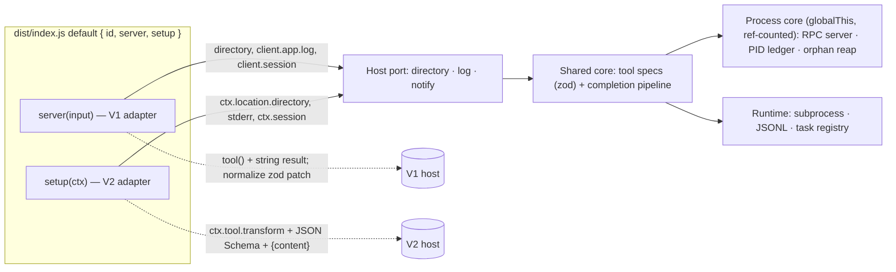

# feat: Support OpenCode V1 and V2 hosts from one package

## Overview

OpenCode V2 (`@opencode/cli` / `@opencode/plugin` 2.3.x) replaced the plugin API. The plugin package was renamed, plugins are defined with `Plugin.define({ id, setup })`, tools register through `ctx.tool.transform`, there is no `client` or `$`, and the TUI API is new. This plugin currently loads only on V1 (`@opencode-ai/plugin` 1.x).

This plan keeps one package and one default export that serves both hosts, following `marcusrbrown/systematic`. The host-agnostic runtime (subprocess, JSONL, task registry, RPC, PID ledger, reaper) stays shared. Thin V1 and V2 adapters cover the server entry, tools, notifications, logging, and later the TUI. It also folds in #530 item 2: tool hooks become per-directory instead of first-caller-wins per process.

## Problem Frame

- V2 hosts can't load the plugin. `fro-bot/agent` and other V2 adopters already run stock V2 only.
- Serving V2 alone would strand every V1 user. The repo's peer floor is `>=1.14.41`, and the `mise.toml` host is `1.19.6`.
- The per-process singleton (`src/runtime/plugin-singleton.ts`) gives the first factory call real hooks and every later call `{}`. A shared server with several workspaces gets no tools after the first one (#530 item 2). V2 runs `setup` per location, and the plugin can be reloaded and reactivated, so the singleton's assumptions break outright on V2.

## Requirements Trace

- R1. On a V1 host (floor through `1.19.x`), the plugin loads and behaves exactly as today: four `copilot_*` tools, notifications, and the TUI.
- R2. On a V2 host (`2.3.x`), the plugin loads, registers the same four tools with equivalent inputs and outputs, and delivers completion to the parent session.
- R3. One package, one default export. `dist/index.js` exports only `default` (the regression contract from the 2026-05-11 plan, R3–R5). The V1 legacy loader iterates named exports, so no second export is allowed.
- R4. Each directory a host process serves gets its own tool hooks bound to that directory. Duplicate config sources for the same directory still get `{}` on V1 (the #76/#108 contract). Process-wide resources (RPC server, PID ledger, orphan reap) start once per process and are released when the last user goes away.
- R5. V2 reload and reactivation is safe: `setup`'s cleanup releases everything it acquired, so a re-run never hits `EADDRINUSE` or leaks PID entries.
- R6. Notifications never fail a tool call on either host. Where V2 can't express a V1 behavior (`noReply` injection), the degraded behavior is chosen deliberately and documented.
- R7. CI proves both hosts on every PR that touches the contract surface: the export-shape smoke test plus a host-contract load test against the V1 floor, V1 current, and V2 pinned.
- R8. The TUI half works on both hosts (phase 2), within the OpenTUI constraints: V1 host 0.4.5, V2 peer `>=0.8.4`.

## Scope Boundaries

- Copilot CLI behavior, tool semantics, and JSONL parsing stay as they are.
- No new tools. The unshipped session-continuity Units 4–6 (`docs/plans/2026-05-02-001-feat-copilot-session-continuity-resume-connect-plan.md`) stay deferred.
- No V2-only features (permissions, MCP, references, integrations) beyond what parity needs.
- No dropping V1 support in this plan.

### Deferred to Separate Tasks

- OpenTUI 0.4.5 alignment and the `brace-expansion` override: `docs/plans/2026-11-20-001-fix-opentui-host-alignment-plan.md` (lands first).
- Integration tests that need model auth (#38). The host-contract tests here only load the plugin and list or call tools against a fake `copilot` binary.

## Context & Research

### Relevant Code and Patterns

- `src/index.ts`: the V1 factory. It wires `input.directory` and `input.client` into the tools, the RPC runtime, the reaper, and `plugInOnce`. A test hook (`__captureRpcCleanup`) needs re-homing.
- `src/tools/{delegate,output,cancel,resume}.ts`: V1 `tool()` with zod args and JSON-string results.
- `src/runtime/notify.ts`: `client.session.prompt/promptAsync({ noReply, parts: [{ synthetic: true }] })`, `client.app.log`, `client.tui.showToast`.
- `src/runtime/plugin-singleton.ts`: a `globalThis` `Symbol.for` singleton. Its state must live on `globalThis`, because module state resets between factory calls (#76 probe).
- `src/lib/normalize-tool-arg-schemas.ts`: patches zod JSON Schema metadata for the V1 host's separate zod. It is V1-only.
- `scripts/build.ts`: the server is built with `target: 'node'`, the TUI with `target: 'bun'` plus `@opentui/solid/bun-plugin`. Externals are listed.
- `.github/workflows/ci.yaml`: a Node ESM export-shape smoke test that asserts `typeof default === 'function'`. That assertion changes in this plan.
- Systematic's main branch, the reference implementation. One default object, `{ id, setup, server }`. `setup` returns early when `!ctx.location || !ctx.session` (V1's reduced bridge). Adapters live in `src/lib/opencode-v1.ts` and `src/lib/opencode-v2*.ts`. Two optional peers. The public `.d.ts` types the entry as `unknown`. CI runs a Host Contract job: four V2 shards, the V1 floor, and V1 current, with pins in `scripts/opencode-host-pins.json`.

### Host Facts (verified against source unless marked)

| Concern                 | V1 (`v1.19.6`)                                                                                      | V2 (`v2.3.2`)                                                                                                                                            |
| ----------------------- | --------------------------------------------------------------------------------------------------- | -------------------------------------------------------------------------------------------------------------------------------------------------------- |
| Server entry resolution | `exports["./server"]`, else `main`                                                                  | `server` subpath, else root `"."`                                                                                                                        |
| Default shape           | Object with `id` + `server`, or a legacy factory (then every named export is iterated as a factory) | Must be `{ id, setup }` or `{ id, effect }`; named exports ignored                                                                                       |
| `oc-plugin` field       | —                                                                                                   | Not read (inferred)                                                                                                                                      |
| Per-directory           | One factory call per instance directory (`InstanceState`)                                           | `setup` per location; module cached per file digest                                                                                                      |
| Dedupe                  | None; each config source calls the factory                                                          | By `id` within an instance                                                                                                                               |
| Tools                   | `tool()` + zod, string result                                                                       | `tools.add({ name, description, input, execute })`; `input` is effect Schema, Standard Schema, or JSON Schema; result `{ output?, content?, metadata? }` |
| Session injection       | `session.prompt/promptAsync({ noReply })`                                                           | `session.synthetic({ text, ... })`, `session.prompt({ delivery: steer \| queue })`; **no `noReply`**                                                     |
| Logging                 | `client.app.log`                                                                                    | None; stderr only (Systematic uses prefixed `console.error`)                                                                                             |
| TUI module sharing      | `@opentui/solid/runtime-plugin-support` (default list unread)                                       | Shares only `effect` and `@opencode/plugin`; the plugin's own `solid-js`/`@opentui/*` load (inferred context-identity risk)                              |
| Runtime                 | Node or Bun (server)                                                                                | Server Node or Bun; TUI Bun-only                                                                                                                         |

### Institutional Learnings

- `docs/plans/2026-05-11-001-feat-plugin-contract-and-tui-api-resilience-plan.md` (recorded as completed; shipped in #121 and #123). Keep default-only exports, the Node build target, and the failing CI gate. Its R6 (keep `plugInOnce`, reject per-load models) is **partly superseded** here: V1 keeps per-directory dedupe, and V2 drops the guard in favor of `setup` and cleanup.
- `docs/research/copilot-memory-experiment-2026-05-03.md`: the dual pattern. Both `normalizeToolArgSchemas` and `plugInOnce` are required on V1; either alone is insufficient.
- `docs/solutions/integration-issues/two-entrypoint-rpc-tui-hardening-2026-05-01.md`: RPC and TUI startup stay best-effort and never block tool registration. Validate the session discriminator, clean up only exact stale port files, and keep the export smoke test.
- `docs/solutions/best-practices/per-instance-pid-files-spawner-liveness-gating-2026-04-28.md` and `docs/plans/2026-04-27-002-fix-runtime-hardening-plan.md` (completed): the PID ledger assumes one spawner per host process. Per-directory hooks in one process must share one spawner identity, or the liveness gate must be re-keyed.
- `docs/solutions/ui-bugs/re-entrant-dialog-close-froze-copilot-status-on-escape-2026-05-02.md`: the host owns dialog close. The V2 `ui.dialog.show` path needs the same no-re-entrant-close test.
- `docs/plans/2026-04-21-copilot-delegate-plugin.md` (T4): the notification contract. `noReply: true` injects while tasks are still running, and `noReply: false` is used only when the last in-flight task completes.

## Prior-Art Survey

```json
{
  "schema_version": 2,
  "verdict": "extend",
  "scope": "src/index.ts, src/tools/, src/runtime/{notify,plugin-singleton,rpc-server,pid-file,orphan-reaper}.ts, src/lib/, src/tui/, scripts/build.ts, .github/workflows/ci.yaml",
  "freshness": {
    "vcs_reference": "origin/main@15b2a9a"
  },
  "budget": {
    "max_search_passes": 3,
    "max_candidate_inspections": 8,
    "exhausted": false
  },
  "candidates": [
    {
      "path_or_symbol": "src/runtime/plugin-singleton.ts plugInOnce",
      "description": "Process-wide register-once guard on globalThis; duplicates get {}",
      "disposition": "extend"
    },
    {
      "path_or_symbol": "src/runtime/notify.ts",
      "description": "Completion injection via client.session prompt with noReply, toast, app.log",
      "disposition": "extend"
    },
    {
      "path_or_symbol": "src/tools/*.ts",
      "description": "Four V1 tool definitions mixing schema, execution, and host result shape",
      "disposition": "extend"
    },
    {
      "path_or_symbol": "src/lib/normalize-tool-arg-schemas.ts",
      "description": "V1-only zod JSON Schema metadata patch",
      "disposition": "reuse"
    },
    {
      "path_or_symbol": "src/runtime/{subprocess,task-registry,jsonl-parser,envelope,rpc-server,pid-file,orphan-reaper}.ts",
      "description": "Host-agnostic runtime",
      "disposition": "reuse"
    }
  ]
}
```

## Key Technical Decisions

- **One default object `{ id, server, setup }` (and `{ id, tui, setup }` for `./tui`).** Systematic proves V1 1.19 reads `server` and V2 reads `setup`. A single file avoids depending on the untested `main`-vs-`"."` split, and it keeps the default-only contract. `setup` returns early on V1's reduced bridge (`!ctx.location || !ctx.session`).
- **Adapters at the edges, one core.** The shared core takes a small host port: directory, a log sink, and a notification sink. It returns tool specs (name, description, zod schema, execute returning a plain result). The V1 adapter wraps each spec in `tool()` and serializes to a string. The V2 adapter registers through `ctx.tool.transform` with JSON Schema `input` generated from the same zod schema, and returns `{ content }`. Systematic hand-writes JSON Schema for V2; we generate it so the four tools can't drift between hosts.
- **Process core with reference counting.** RPC server, PID ledger, and orphan reap start once per process behind a `globalThis` handle with acquire and release. V1 acquires on the first factory call and never releases, which is today's behavior. V2 acquires in `setup` and releases in cleanup. The last release closes the RPC server and truncates the ledger. This satisfies R4 and R5 and keeps one spawner identity per PID for the liveness gate.
- **Per-directory hooks.** V1 keeps `plugInOnce`'s dedupe, but keyed by `directory`. The first call for a directory gets hooks bound to it, and repeat calls for the same directory get `{}` (#530 item 2). V2 needs no guard, because its registry dedupes by `id` per instance. Tools also prefer the per-call directory when the host supplies one.
- **V2 notifications degrade explicitly.** V2 has no `noReply`. Running-progress injections are dropped on V2. The final "all tasks complete" notification uses `session.synthetic` (or `prompt` with `delivery: queue`, whichever the spike shows doesn't interrupt an active turn), because that notification is meant to start a turn anyway (T4 `noReply: false`). `copilot_output` remains the reliable pull path. The README documents the difference.
- **Logging on V2 goes to stderr** with an `opencode-copilot-delegate:` prefix behind the same log-sink port, matching Systematic. The no-secrets-in-logs rule still applies.
- **Peers and versions.** Both peers are optional: `@opencode-ai/plugin` and `@opencode/plugin >=2.3.0`. The V1 floor rises to the earliest version whose loader accepts an object default with `server`; that version is confirmed in Unit 1 and is probably above `1.14.41`. Add `@opencode/plugin` 2.3.x as a devDependency. Adding it is an ask-first dependency change; get approval at Unit 2. Ship as a `minor` in the 0.x series, with a changeset calling out the raised V1 floor.
- **Public types.** `dist/index.d.ts` types the default as `unknown`, so neither host's types leak to consumers.
- **TUI is phase 2.** The TUI is opt-in, Bun-only on V2, and blocked on OpenTUI `>=0.8.4` plus the solid-js context-identity question. Server parity ships first.

## Open Questions

### Resolved During Planning

- Can one package serve both hosts? Yes, with one default object (Systematic, verified).
- Do V2 hosts iterate named exports? No. Only `default` is decoded.
- Does V2 need the zod metadata patch? No, because V2 receives JSON Schema. The patch stays on the V1 path only.

### Deferred to Implementation (resolved by Unit 1 spikes)

- Which V1 version first accepts `{ id, server }` defaults. This sets the new peer floor.
- Does V2 run `setup` once per location or once per activation, and does reactivation call the prior cleanup first?
- Exact `session.synthetic` / `prompt` argument shapes, and whether `delivery: queue` waits for the current turn.
- Does a zod 4 schema work as V2 `input` at runtime (Standard Schema), making JSON Schema generation unnecessary?
- V2 TUI: which `solid-js` and `@opentui/*` copy loads, and does `PluginContextProvider` identity survive? Does V1's `runtime-plugin-support` share Solid?
- Do `src/tui/components/*` use APIs that OpenTUI 0.6–0.9 removed (`useThread` in tests, factories, ScrollBox)?

## High-Level Technical Design

> _This illustrates the intended approach and is directional guidance for review, not implementation specification. The implementing agent should treat it as context, not code to reproduce._



## Implementation Units

### Phase 0: Spikes (no shipped behavior)

- [ ] **Unit 1: Host contract spikes**

**Goal:** Turn every deferred question above into a recorded fact before code moves.

**Requirements:** R1–R5, R8 (de-risking)

**Dependencies:** None

**Files:**

- Create: `docs/research/opencode-v2-host-contract-2026-11.md`

**Approach:**

- Use throwaway probe plugins against `opencode-ai` (the V1 floor candidates, plus 1.19.6) and `@opencode/cli` 2.3.x. Answer each deferred question with the version tested and the evidence.
- Probe: the V1 object-default floor; `setup` frequency and cleanup ordering across two directories and one reload; `synthetic` and `prompt` turn behavior; a zod `input` at runtime; Solid and OpenTUI module identity in a V2 TUI.

**Test scenarios:**

- Test expectation: none. This unit is a research artifact, and later units carry the tests that encode its findings.

**Verification:** Every deferred question has a verified answer or an explicit "unknown + chosen fallback" entry in the research doc.

### Phase 1: Server dual-host

- [ ] **Unit 2: Extract the shared core and host port**

**Goal:** Separate the tool specs and completion pipeline from V1 host types, with no behavior change.

**Requirements:** R1, R3

**Dependencies:** Unit 1

**Files:**

- Create: `src/core/` modules (tool specs, host port types)
- Modify: `src/tools/*.ts`, `src/runtime/notify.ts`, `src/index.ts`
- Test: `tests/tools.test.ts`, `tests/notify.test.ts`, `tests/index.test.ts`, new `tests/core-*.test.ts`

**Approach:** Refactor so each tool's execute logic receives a host port, and the V1 `tool()` wrapping happens in one adapter. Keep the `{ error }` structured results.

**Execution note:** Characterization first. The existing tool and notify tests must pass unchanged before and after the extraction.

**Test scenarios:**

- Happy path: each of the four tool specs runs through a fake host port and returns the same envelope the V1 tool returns today.
- Error path: a spec error yields `{ error }` and never throws across the port.
- Integration: the V1 adapter registers four tools with `execute` (same assertion as the CI gate).

**Verification:** Full unit and TUI suites green, with no diff in tool output for the existing fixtures.

- [ ] **Unit 3: Reference-counted process core and per-directory V1 hooks**

**Goal:** Fix #530 item 2 and make process resources releasable.

**Requirements:** R4, R5

**Dependencies:** Unit 2

**Files:**

- Modify: `src/runtime/plugin-singleton.ts` (and its header comment recording the partial supersession of 2026-05-11 R6), `src/index.ts`, `src/runtime/pid-file.ts` if the ledger key changes
- Test: `tests/plugin-singleton.test.ts`, `tests/index.test.ts`, `tests/orphan-reaper.test.ts`, `tests/rpc-cleanup.test.ts`

**Approach:** Keep the `globalThis` handle. Key hook dedupe by directory. Process resources use acquire and release with a count. The V1 path never releases.

**Test scenarios:**

- Happy path: two factory calls with different directories in one process both get four tools, and each tool's `cwd` and resume root is its own directory.
- Edge case: two calls with the same directory get real hooks first and `{}` second (the #108 contract).
- Edge case: module state reset between calls (simulated by a fresh import) still dedupes, because state lives on `globalThis`.
- Integration: acquire → acquire → release → release closes the RPC server exactly once and truncates the ledger. A third acquire rebinds cleanly with no `EADDRINUSE`.
- Error path: an RPC bind failure leaves tool registration intact (the non-fatal rule).

**Verification:** Suites green. The README states multi-workspace support.

- [ ] **Unit 4: V2 server adapter**

**Goal:** The same four tools and the completion pipeline on V2.

**Requirements:** R2, R5, R6

**Dependencies:** Units 2–3; approval to add the `@opencode/plugin` devDependency and optional peer

**Files:**

- Create: `src/hosts/v2.ts` (or the adapter location Unit 2 establishes)
- Modify: `src/index.ts` (default object `{ id, server, setup }`), `package.json` (peers, devDependency), `bun.lock`, `scripts/build.ts` (externals), `.changeset/*.md`
- Test: new `tests/host-v2.test.ts`

**Approach:**

- `setup` uses the reduced-bridge guard, then acquires the process core and registers tools via `ctx.tool.transform` with generated JSON Schema (or zod directly, if Unit 1 proved it works).
- The notify sink follows the degradation decision. Logs go to the prefixed stderr sink. The returned cleanup releases the process core.

**Test scenarios:**

- Happy path: a fake V2 context records `tools.add` calls for exactly the four tools, with input schemas equivalent to the zod schemas (name, required fields, descriptions).
- Happy path: execute returns `{ content }` with the same envelope text V1 returns.
- Edge case: `setup` called with a V1-style reduced bridge returns without registering anything.
- Integration: setup → cleanup → setup re-registers cleanly and leaves one RPC server (R5).
- Error path: a notification sink failure is swallowed and logged; the tool result is unaffected (R6).
- Edge case: with several tasks in flight, intermediate completions produce no V2 injection, and the last completion produces one synthetic message.

**Verification:** Unit suites green, the export smoke test passes with the new shape, and `dist/index.d.ts` types the default as `unknown`.

- [ ] **Unit 5: CI host-contract gate**

**Goal:** Prove R1–R3 and R7 on every contract-touching PR.

**Requirements:** R3, R7

**Dependencies:** Unit 4

**Files:**

- Modify: `.github/workflows/ci.yaml` (smoke test asserts `default` has `id`/`server`/`setup`, calls `server()` with a V1-shaped input and checks the four tools, and calls `setup()` with a fake V2 context)
- Create: a host-pins file (for example `scripts/opencode-host-pins.json`), `tests/host-contract/` load tests
- Modify: `mise.toml` only if a V2 CLI tool entry is needed

**Approach:**

- Mirror Systematic's Host Contract job: a path-filtered job matrix over the V1 floor, V1 current, and V2 pinned.
- Each job starts the host with config-dir isolation (per the CLI integration-testing learning), loads the built plugin, lists tools, and runs `copilot_delegate` against the fake `copilot` fixture.
- One aggregator job is the required check. Changing CI is ask-first; confirm with Marcus at this unit.

**Test scenarios:**

- Integration: on each host pin, the plugin loads and exactly four `copilot_*` tools appear.
- Integration: `copilot_delegate` against the fake binary completes, and `copilot_output` returns the envelope.
- Error path: a deliberately added named export fails the smoke test.

**Verification:** The matrix is green on a PR. A red-team PR with a named export fails it.

### Phase 2: TUI dual-host

- [ ] **Unit 6: OpenTUI 0.9.x on the TUI half**

**Goal:** Meet V2's `>=0.8.4` peer without breaking V1.

**Requirements:** R8

**Dependencies:** The OpenTUI alignment plan merged; Unit 1's module-identity findings

**Files:**

- Modify: `package.json`, `bun.lock`, `src/tui/components/*`, `src/tui/__tests__/*` (`useThread` removal, async `destroy`)

**Approach:** Choose the version by Unit 1's finding. If V1 shares host OpenTUI copies, the plugin's version mostly affects types and tests. If not, check that 0.9.x components render correctly inside the V1 0.4.5 host.

**Test scenarios:**

- Integration: `test:tui` passes with the 0.9 test-renderer options.
- Integration: the re-entrant close and load-error regression tests still pass.
- Edge case: modal layout snapshots (`captureCharFrame`) match, or the change is reviewed (0.8.1/0.8.2 zero-size and wrap changes).

**Verification:** Suites green, and the live Esc check passes on the V1 host.

- [ ] **Unit 7: V2 TUI adapter**

**Goal:** `/copilot-status` on V2.

**Requirements:** R8

**Dependencies:** Unit 6

**Files:**

- Modify: `src/tui/index.tsx` (the default `{ id, tui, setup }`; extend the registration ladder with `ctx.keymap.layer`; dialogs via `ctx.ui.dialog.show`; cleanup from `setup`)
- Test: `src/tui/__tests__/index.test.ts`

**Approach:** Keep `src/tui/rpc-client.ts` and the components host-agnostic. Only registration, dialog, and toast wiring differ per host. The host owns close on both.

**Test scenarios:**

- Happy path: the V2 setup registers one palette and slash command named `copilot-status`.
- Integration: opening the dialog and then pressing Esc produces no re-entrant `clear` call (the ui-bugs learning).
- Error path: an RPC failure renders the error state and doesn't throw.
- Edge case: a V1 `api` without `keymap.layer` still uses the existing ladder.

**Verification:** TUI suites green, and a live check on both hosts.

- [ ] **Unit 8: Docs and contract record**

**Goal:** Users and agents know what works where.

**Requirements:** R6, R7

**Dependencies:** Units 4–7

**Files:**

- Modify: `README.md` (install for V1/V2, the notification difference on V2, multi-workspace support), `AGENTS.md` (adapters and process core in the architecture tree; the dual-host design decision)
- Create: a `docs/solutions/` entry for the dual-host contract, via `ce:compound`

**Test scenarios:**

- Test expectation: none. Documentation only.

**Verification:** The docs match the shipped behavior, and Fro Bot's doc-drift check reports nothing.

## System-Wide Impact

- **Interaction graph:** every host entry point (server factory, TUI entry), the tool registry, the notification injection, the RPC server, and the reaper.
- **Error propagation:** host-adapter failures (notify, log, RPC) stay non-fatal. Only tool input validation errors surface to the model, as `{ error }`.
- **State lifecycle risks:** V2 reactivation (R5); per-directory hooks sharing one PID ledger; port files keyed by session discriminator across directories.
- **API surface parity:** the four tools must match across hosts in name, description, schema, and envelope. Generating V2 schemas from zod enforces this.
- **Unchanged invariants:** default-only export; `{ error }` results; no secrets in logs or tool output; Copilot CLI spawn flags; the `cpl_` task IDs.

## Risks & Dependencies

| Risk                                                         | Likelihood | Impact | Mitigation                                                                                                      |
| ------------------------------------------------------------ | ---------- | ------ | --------------------------------------------------------------------------------------------------------------- |
| V1 floor must rise above 1.14.41                             | High       | Med    | Unit 1 measures it; the changeset and README call it out; `minor` in 0.x                                        |
| No V2 `noReply` means noisier or missing progress injections | High       | Med    | Explicit degradation (final-only synthetic) plus the `copilot_output` pull path; documented                     |
| V2 reactivation leaks the RPC port                           | Med        | High   | Ref-counted process core plus the setup → cleanup → setup test                                                  |
| Solid/OpenTUI context identity breaks the V2 TUI             | Med        | Med    | TUI is phase 2, gated on the Unit 1 probe; the server ships independently                                       |
| CI matrix cost and flakiness                                 | Med        | Low    | Path-filtered job, fake `copilot`, no model auth; the existing wall-clock-flaky unit tests are fixed separately |
| Adding `@opencode/plugin` and CI changes are ask-first       | —          | —      | Approval checkpoints at Units 4 and 5                                                                           |

## Sources & References

- Related issues and PRs: #530 (item 2), #38, #561 (shared RPC path module), #556/#558 (Fro Bot report context)
- Related past work: `docs/plans/2026-05-11-001-feat-plugin-contract-and-tui-api-resilience-plan.md`, recorded as completed. This plan keeps its export and CI decisions and partly supersedes its R6 singleton decision.
- Related past work: `docs/plans/2026-05-02-001-feat-copilot-session-continuity-resume-connect-plan.md`, recorded as active. Its unshipped Units 4–6 stay out of scope.
- External: anomalyco/opencode `v2.3.2` (`packages/plugin/src/{promise/plugin.ts,promise/tool.ts,promise/session.ts,host.ts,runtime-modules.ts,source.ts}`, `packages/core/src/plugin/{module.ts,instance.ts}`, `packages/schema/src/{tool.ts,session-inbox.ts}`); anomalyco/opencode `v1.19.6` (`packages/opencode/src/plugin/{shared.ts,loader.ts,index.ts,tui/runtime.ts}`); marcusrbrown/systematic main (`src/index.ts`, `src/lib/opencode-v1.ts`, `src/lib/opencode-v2*.ts`, `.github/workflows/main.yaml`).
